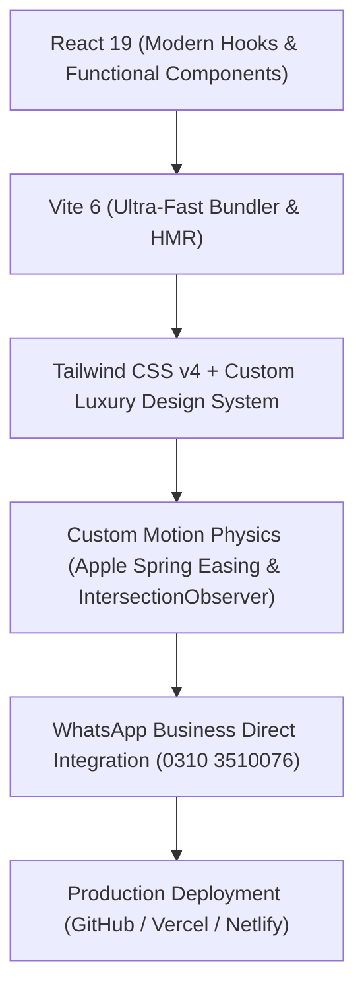

# GM Dairies Karachi — Official Client Delivery Documentation

> **Platform:** GM Dairies Online Store & Morning Milk Subscription Web Application  
> **Client:** GM Dairies (Karachi, Pakistan)  
> **Physical Hub:** Near Moti Mahal, Block 2, Gulshan-e-Iqbal, Karachi  
> **Official Hotline & WhatsApp:** `+92 310 3510076`  
> **Git Repository:** `https://github.com/armanh148/GM-Dairies.git`  
> **Status:** Production-Ready • Fully Tested & Built  

---

## 1. Executive Summary & Business Objective

**GM Dairies** is a premium organic dairy producer based in Gulshan-e-Iqbal, Karachi. The primary business challenge addressed by this web application was bridging the gap between social media demand and doorstep fulfillment.

### Core Problems Solved:
1. **Converting Social Demand:** Frequently asked Instagram & Facebook inquiries (*"Online delivery available?"*) are now routed directly through an automated digital storefront.
2. **Recurring Morning Revenue:** Karachi households can configure an automated daily morning milk subscription with guaranteed chilled delivery before breakfast (5:30 AM – 8:30 AM).
3. **Purity Confidence:** Countering loose, powdered, and adulterated milk in Karachi through transparent lactometer batch-testing guarantees, farm-chilling standards (<4°C), and a 100% money-back at-home purity pledge.
4. **Frictionless WhatsApp Ordering:** Zero mandatory login or payment friction. Every cart checkout and subscription request formats an itemized, professional Urdu/English receipt message sent directly to GM Dairies' WhatsApp hotline (`0310 3510076`).

---

## 2. Technology Stack & Architecture



| Technology | Purpose | Implementation Detail |
|---|---|---|
| **React 19** | Core Frontend Library | Functional state management, custom hooks, reusable modular components |
| **Vite 6** | Build & Dev Tooling | Production build in under 5 seconds, optimized asset tree-shaking |
| **Tailwind CSS v4** | Styling & Layout Engine | Dynamic responsive grid utilities, container max-width at 1600px |
| **Lucide React** | Micro-Icon System | SVG icons for dairy traits, delivery steps, map navigation, and cart |
| **IntersectionObserver** | Scroll Animation Engine | Hardware-accelerated fluid scroll-reveal without heavy bundle dependencies |
| **Git & GitHub** | Version Control | Source code synced at `https://github.com/armanh148/GM-Dairies.git` |

---

## 3. Delivered Features & Component Breakdown

### 3.1. Luxury Top Announcement Bar & Navigation (`Navbar.jsx`)
- **Responsive Announcement Bar:**
  - **Desktop:** Live pulsing green dot, *"Morning Dispatch"* tag, *"🥛 100% Pure Organic Milk & Desi Ghee Across Karachi"*, Gulshan depot location, and direct 0310 hotline link.
  - **Mobile:** Streamlined, single-line format (`🟢 🥛 Pure Milk & Desi Ghee` | `📞 0310 3510076`) that **never wraps awkwardly or truncates**.
- **Glassmorphic Navigation Bar:** Frosted translucent glass background with brand seal (`GM`), category links, milk subscription discount badge (`5% Off`), and responsive drawer menu for smartphones.
- **Interactive Cart Trigger:** Displays real-time item count with a playful bounce animation on item addition.

---

### 3.2. Editorial Hero Section (`Hero.jsx`)
- **Editorial Typography:** High-contrast serif headlines (`Playfair Display`) paired with clean geometric sans (`Plus Jakarta Sans`).
- **Live Dispatch Badge:** Pulsing status badge: *"Online Orders Live • Next Morning 6:00 AM Dispatch"*.
- **Key Value Grid:** 6 micro-cards covering 0% added water, oxytocin-free cattle, <4°C chilling, bilona churned ghee, early morning drops, and Moti Mahal depot pickup.
- **CTA Buttons:** Dual call-to-actions with diagonal light-reflection sheen (`.btn-shimmer`): *"Start Daily Milk Subscription"* and *"Browse Store Catalog"*.
- **Floating Motion Product Showcase:** High-resolution product showcase featuring Buffalo Milk with floating quality badges (`animate-float` and `animate-float-reverse`).

---

### 3.3. Continuous Flowing Trust Ticker (`TrustTicker.jsx`)
- Seamless 36-second infinite marquee ticker positioned between the Hero and Community sections.
- Displays key trust markers:
  - 🥛 100% Raw Buffalo & Cow Milk
  - 🧪 Lactometer Tested Purity • 0% Added Water
  - ❄️ Chilled Doorstep Delivery Under 4°C
  - 🧈 Bilona Churned Danedar Desi Ghee
  - 🚫 Zero Hormones & No Synthetic Oxytocin
  - ⭐ 4.8 Rating from 5,000+ Karachi Breakfast Tables
- Silky smooth pause on user hover.

---

### 3.4. Instagram Community Proof Section (`InstagramStoryBanner.jsx`)
- Directly highlights genuine customer queries (*"Online Available in Karachi?"*) and GM Dairies' official verified replies.
- **Strictly 4 Cards in 1 Row on Desktop (`md:grid-cols-4`)** and **Strictly 2 Cards in 1 Row on Mobile (`grid-cols-2`)**.
- Features customer avatars, like counters, comment bubble styling, verified green badge replies, and 1-tap WhatsApp reply triggers.

---

### 3.5. Interactive Morning Milk Subscription Planner (`SubscriptionPlanner.jsx`)
- **Step 1: Milk Variety:** Buffalo Milk (6.8% fat, Rs. 270/L) vs. Farm Cow Milk (4.2% fat, Rs. 280/L).
- **Step 2: Liters Selector:** 1L, 2L, 3L, 4L daily volume options with family size recommendation tags.
- **Step 3: Delivery Frequency:** Strictly 3 buttons in 1 horizontal row (`Everyday`, `Alternate Days`, `Weekdays Only`).
- **Step 4: Delivery Preferences:**
  - **Custom Morning Time Slot Popover:** Early Morning (5:30–6:30 AM), Standard (6:30–7:30 AM), Morning Rush (7:30–8:30 AM).
  - **Custom Karachi Delivery Area Popover:** 10 mapped Karachi zones with smooth scroll list.
  - *No ugly native browser blue OS select popups.*
- **Interactive Ticket Receipt:** Calculates monthly volume, regular price, 5% subscriber discount, monthly bill, and cost per drop.
- **Automated WhatsApp Booking:** Formats a prefilled, structured subscription agreement delivered directly to `0310 3510076`.

---

### 3.6. Product Catalog & Storefront (`ProductCatalog.jsx` & `ProductCard.jsx`)
- **Category Filter Pills:** All Dairy (6), Organic Milk (2), Desi Ghee & Butter (2), Thick Dahi (1), Paneer & Khoya (1) with active product count counters.
- **Search & Filter Suite:** Live keyword search input with quick-clear icon, "Daily Subscription Only" toggle pill, and custom luxury Sort Popover (Featured, Price Low to High, Price High to Low).
- **Strictly 5 Products in 1 Row (`.slider-5-col`):** Desktop view displays 5 cards visible across the screen at once with smooth `<` and `>` arrow navigation.
- **Product Card Physics:**
  - Smooth 700ms image zoom on card hover (`group-hover:scale-110`).
  - Tactile `-6px` elevation lift with ambient emerald shadow glow.
  - Fat content percentage badge, size options (500g vs. 1kg for Desi Ghee).
  - Dual CTAs: Green WhatsApp direct order button + Add to Cart with checkmark animation.
- **Wholesale Banner:** Callout for bakeries, restaurants, and catering bulk orders (10L+ daily milk or commercial Desi Ghee).

---

### 3.7. Purity Guarantee Bento Section (`PurityGuarantee.jsx`)
- 4 Core Purity Pillars:
  1. **0% Added Water Guarantee:** Daily lactometer verification.
  2. **Zero Hormones / Oxytocin:** Natural green fodder pasture grazing.
  3. **Instant Chilling Under 4°C:** Chilled within 15 minutes of milking.
  4. **Own-Packaged & Sealed:** Bottled hygienically at Gulshan depot.
- **Strictly 4 Cards in 1 Row on Desktop (`md:grid-cols-4`)** and **Strictly 2 Cards in 1 Row on Mobile (`grid-cols-2`)**.
- **At-Home Purity Guarantee Box:** 100% money-back guarantee if customer detects water dilution using their home lactometer or boiling test.

---

### 3.8. Karachi Delivery Routes & Timings (`KarachiDeliveryChecker.jsx`)
- Covers 10 prominent Karachi neighborhoods: Gulshan-e-Iqbal, Gulistan-e-Johar, Federal B Area, PECHS / Bahadurabad, Clifton & DHA, North Nazimabad, Malir Cantt / Scheme 33, Garden / Saddar, KDA Scheme 1 / Tipu Sultan, Buffer Zone / Shadman.
- Strictly 5 delivery zone cards in a row on desktop with area search filter, delivery time slot, and delivery fee status.

---

### 3.9. Customer Reviews & Verified Rating Section (`TestimonialsSection.jsx`)
- **4.8 ★ Rating Card:** Includes 5-star distribution progress bar (92% 5-star reviews from 41+ Karachi families).
- **Desktop View:** Strictly 4 customer review cards side-by-side in 1 row with active glowing emerald border.
- **Mobile View:** Smooth horizontal touch-swipe snap slider (`w-[88%]` cards with peek of adjacent card).
- **Automated Loop:** Cycles through reviews every 3.5 seconds with visual dot indicators and pause on hover.

---

### 3.10. Flagship Depot Location (`LocationCard.jsx`)
- Details physical depot: *Near Moti Mahal, Block 2, Gulshan-e-Iqbal, Karachi*.
- Timings: Open 7 days a week from 6:00 AM to 11:00 PM (fresh stock arrives at 5:00 AM).
- One-click Google Maps GPS navigation link + WhatsApp visit inquiry.

---

### 3.11. Slide-Over Cart Drawer & WhatsApp Checkout (`CartDrawer.jsx`)
- Slide-over drawer with backdrop blur.
- Live quantity adjustment (`+` / `-`), individual item removal, and clear-all option.
- Dynamic free delivery tracker (Unlocks FREE delivery across Karachi on orders above Rs. 1,500).
- Custom dropdowns for Karachi delivery areas and morning delivery slots.
- **WhatsApp Checkout:** Compiles the complete itemized order with prices, quantities, delivery fees, customer name, address, and delivery slot, sending it directly to `0310 3510076`.

---

## 4. Layout & Responsive Specifications

| Component / Section | Desktop Screen (`>= 768px` / `1024px`) | Mobile Screen (`< 768px`) |
|---|---|---|
| **Global Container** | `max-w-[1600px] mx-auto` | Full width with `px-3` to `px-4` padding |
| **Product Catalog** | **Strictly 5 items in 1 row** (`.slider-5-col`) | Horizontal snap slider (`85%` width peek) |
| **Purity Guarantee** | **Strictly 4 cards in 1 row** (`md:grid-cols-4`) | **Strictly 2 cards in 1 row** (`grid-cols-2`) |
| **Instagram Community** | **Strictly 4 cards in 1 row** (`md:grid-cols-4`) | **Strictly 2 cards in 1 row** (`grid-cols-2`) |
| **Delivery Frequency** | **Strictly 3 buttons in 1 row** (`grid-3-row`) | **Strictly 3 buttons in 1 row** (`grid-3-row`) |
| **Customer Reviews** | **Strictly 4 reviews in 1 row** (`md:grid-cols-4`) | **Horizontal swipeable slider** with `<` / `>` |
| **Top Announcement** | Full text with depot & phone link | Compact 1-liner with ping dot & hotline |

---

## 5. Animation & Motion Design System

1. **Apple/iOS Spring Deceleration (`cubic-bezier(0.16, 1, 0.3, 1)`):** Applied to all card elevations, dropdown animations, and scroll reveals to eliminate abrupt mechanical stops.
2. **Scroll-Reveal Observer (`useScrollAnimation.js`):** Lightweight, hardware-accelerated IntersectionObserver that slides and fades elements as they enter the screen (`.scroll-slide-up`, `.scroll-slide-left`).
3. **Smooth Scroll Behavior:** Global `html { scroll-behavior: smooth; }` ensures navbar links glide to target sections.
4. **Button Sheen (`.btn-shimmer`):** Moving diagonal light reflection across primary CTA buttons on hover.
5. **Floating Motion:** Subtle 6s floating keyframe animations (`animate-float`) on quality seals and social proof pills.
6. **Card Elevation:** Cards elevate `-6px` to `-8px` with ambient emerald glow on hover (`rgba(11, 43, 30, 0.14)`).

---

## 6. How the Client Can Run & Deploy

### Local Development Setup:
```bash
# 1. Clone repository
git clone https://github.com/armanh148/GM-Dairies.git
cd GM-Dairies

# 2. Install dependencies
npm install

# 3. Start local development server
npm run dev
# Server runs on: http://localhost:5173
```

### Production Build:
```bash
npm run build
# Generates production distribution in the /dist folder
```

### 1-Click Hosting Recommendations:
- **Vercel / Netlify:** Connect the GitHub repository `https://github.com/armanh148/GM-Dairies.git`. Build command is `npm run build`, output directory is `dist`.
- **Custom Domain:** Point `gmdairies.pk` or `gmdairies.com` via DNS CNAME records.

---

## 7. Deliverables & Handoff Checklist

- [x] Full source code committed and pushed to GitHub (`main` branch).
- [x] Production build tested and verified with zero errors (`npm run build`).
- [x] Clean responsive layout verified on Desktop (1600px, 1440px, 1366px), Tablet (768px), and Mobile (320px–480px).
- [x] All native OS blue select dropdowns replaced with luxury custom popovers.
- [x] All WhatsApp CTAs connected directly to `+92 310 3510076`.
- [x] Complete client documentation provided.
